# 📱 Awesome-Mobile-Productivity-Platform

  

  
  
  
  
  
  

---

## ⚡ Top Mobile Productivity Platform Ecosystem

> A comprehensive, SEO-curated index of **Mobile Productivity Platforms**, **Native Task Managers**, **Offline-First Note-Taking Apps**, **Personal Knowledge Management (PKM)**, and **Self-Hosted Digital Workspaces** for iOS and Android.

**Curated List of Enterprise SaaS Products & Open-Source GitHub Projects**  
*Focused on Native Mobile Apps, Offline-First Task Management, CalDAV Sync & Self-Hosted Productivity Suites*  
**Last updated: November 2026**

---

### 🔍 Overview

Welcome to the definitive directory tracking notable **SaaS platforms** and **open-source projects** in the **Mobile Productivity Platform** space. Whether managing complex distributed teams on the go or keeping private personal notes securely offline, these tools enable individuals and organizations to turn mobile devices into high-efficiency command centers.

* **Top Enterprise SaaS Leaders:** Microsoft 365 Mobile, Google Workspace Mobile, Slack Mobile, Atlassian Mobile App, Notion Mobile, Asana Mobile, Monday.com Mobile, ClickUp Mobile, Trello Mobile, and Todoist.
* **Open-Source & Privacy Leaders:** AppFlowy, AFFiNE, Joplin, Logseq, Super Productivity, Notesnook, Standard Notes, Markor, Tasks.org, and Pomodoist.

---

## 📑 Table of Contents

- [📊 Sector Overview & Market Dynamics](#-sector-overview--market-dynamics)
- [☁️ SaaS / Hosted Platforms](#️-saas--hosted-platforms)
- [🔓 Open-Source GitHub Projects](#-open-source-github-projects)
- [🤝 How to Contribute](#-how-to-contribute)
- [💖 Support & Sponsorship](#-support--sponsorship)
- [📈 Star History](#-star-history)
- [⚠️ Disclaimer](#️-disclaimer)

---

## 📊 Sector Overview & Market Dynamics

The global mobile productivity and collaboration software market is estimated at approximately **$65 billion to $75 billion**, projected to exceed **$150 billion by the early 2030s** propelled by remote/hybrid work models, mobile-first deskless workforces, and embedded generative AI assistants. 

The sector exhibits **moderate fragmentation at the application layer**—where numerous specialized tools thrive across note-taking, task management, and project execution—but remains **heavily concentrated at the foundational suite tier** dominated by platform titans (Microsoft 365, Google Workspace) operating as ubiquitous enterprise operating layers.

---

## ☁️ SaaS / Hosted Platforms

| Platform | Description | Pricing (Starting Paid Tier) | Free Tier / Trial Limits | Company Scale (Valuation / Revenue) |
| :--- | :--- | :--- | :--- | :--- |
| **[Microsoft 365 Mobile](https://www.microsoft.com/en-us/microsoft-365)** | Integrated mobile productivity suite combining Word, Excel, PowerPoint, Outlook, OneNote, and Teams on iOS and Android. | $6.00/user/month (Business Basic, billed annually) | Free for basic viewing and lightweight editing on screens under 10.1 inches; includes 5 GB OneDrive cloud storage; 30-day free trial for Microsoft 365 Business Standard. | ~$3.1 Trillion market cap / $245B+ ARR (Microsoft) |
| **[Google Workspace Mobile](https://workspace.google.com/)** | Unified cloud and mobile productivity tools covering Gmail, Google Drive, Docs, Sheets, Keep, Meet, and Calendar. | $6.00/user/month (Business Starter, 1-year commitment) | Free personal Google Account includes 15 GB shared storage across Gmail/Drive/Photos; 14-day free trial for Google Workspace business tiers. | ~$2.1 Trillion market cap / $40B+ Google Cloud ARR (Alphabet) |
| **[Slack Mobile](https://slack.com/)** | Real-time enterprise messaging, audio/video huddles, channels, direct messages, and notification workflows on iOS and Android. | $7.25/user/month (Pro plan, billed annually) | Free forever plan: 90 days of message/file history, 10 app integrations, and 1:1 audio/video huddles with canvas notes. | $27.7 Billion acquisition valuation (Salesforce subsidiary) |
| **[Atlassian Mobile App](https://www.atlassian.com/)** | Mobile companion for Jira, Confluence, and Bitbucket to monitor sprint tickets, resolve blockers, and view team wikis on the go. | $7.75/user/month (Jira Cloud Standard, billed annually) | Free forever plan for up to 10 users per site across Jira and Confluence with 2 GB file storage and community support. | ~$50 Billion market cap / $4.4B ARR |
| **[Monday.com Mobile](https://monday.com/)** | Visual Work OS delivering mobile project boards, customizable status columns, automations, and executive dashboard tracking. | $9.00/seat/month (Basic plan, billed annually; 3-seat min: $27/mo) | Free forever plan for up to 2 seats, up to 3 boards, 200+ templates, and 500 MB storage; 14-day free trial of Pro plan. | ~$14 Billion market cap / $840M+ ARR |
| **[Notion Mobile](https://www.notion.com/)** | All-in-one workspace mobile app unifying markdown docs, relational databases, team wikis, and AI notes with offline sync. | $10.00/member/month (Plus plan, billed annually) | Free forever plan for individuals: unlimited pages/blocks, up to 10 page guests, 5 MB file upload limit, and collaborative workspace trial with 1,000 block limit. | $10.00 Billion valuation (private) / $350M+ ARR |
| **[Asana Mobile](https://asana.com/)** | Mobile project and task management enabling list, board, calendar, and timeline views with status updates and approval flows. | $10.99/user/month (Starter plan, billed annually) | Free forever (Personal plan) for up to 10 teammates with unlimited tasks, projects, messages, activity log, and 100+ integrations; 30-day free trial. | ~$3.5 Billion market cap / $650M+ ARR |
| **[ClickUp Mobile](https://clickup.com/)** | All-in-one productivity app organizing tasks, docs, goals, chat, time tracking, and reminders with multi-view customization. | $7.00/user/month (Unlimited plan, billed annually) | Free forever plan: 100 MB storage, unlimited tasks, unlimited free plan members, collaborative docs, and 60 uses of custom fields. | $4.00 Billion valuation (private) / $200M+ ARR |
| **[Trello Mobile](https://trello.com/)** | Kanban card-and-board workflow app with Butler mobile automations, checklists, custom tags, and file attachments. | $5.00/user/month (Standard plan, billed annually) | Free forever plan: up to 10 boards per workspace, unlimited cards, unlimited Power-Ups per board, up to 10 MB per file attachment, and 250 Workspace command runs/month. | $425 Million acquisition valuation (Atlassian subsidiary) |
| **[Todoist](https://todoist.com/)** | Intuitive mobile task manager with natural language parsing, recurring due dates, priority filters, reminders, and cross-platform sync. | $4.00/user/month (Pro plan, billed annually) | Free forever (Beginner plan): up to 5 active projects, 5 guests per project, 5 MB file uploads, 3 filter views, and 1-week activity history. | $100 Million+ estimated valuation (Doist, bootstrapped) / $30M+ ARR |

---

## 🔓 Open-Source GitHub Projects

| Project | Stars | Description | Mobile Highlights |
| :--- | :--- | :--- | :--- |
| **[AppFlowy](https://github.com/AppFlowy-IO/AppFlowy)** |  | Open-source alternative to Notion built with Flutter and Rust, prioritizing data privacy and offline support. | Native iOS and Android apps with full offline local storage, customizable views, Kanban boards, and document editing. |
| **[AFFiNE](https://github.com/toeverything/AFFiNE)** |  | Next-gen workspace combining docs, whiteboards, and multi-dimensional tables into a single canvas. | Native iOS and Android apps; polished doc layout with clean card previews, easy tagging, and journal calendar (edgeless whiteboard is view-focused on mobile). |
| **[Joplin](https://github.com/laurent22/joplin)** |  | Secure, open-source note-taking and to-do application with end-to-end encryption (E2EE) and cross-platform sync. | Production-grade iOS and Android apps with full offline notebook access, camera attachments, tags, search, and WebDAV/Nextcloud/Dropbox sync. |
| **[Logseq](https://github.com/logseq/logseq)** |  | Privacy-first, local-first open-source platform for knowledge management, outliner note-taking, and task tracking. | Native mobile apps for iOS and Android reading and writing directly to local plain-text Markdown and Org-mode files. |
| **[Super Productivity](https://github.com/super-productivity/super-productivity)** |  | Advanced ToDo list, time tracker, and task manager for developers and knowledge workers with Jira/GitHub/GitLab integrations. | Android APK and responsive mobile web app with offline Pomodoro timers, subtasks, work break reminders, and WebDAV/Google Drive sync. |
| **[Notesnook](https://github.com/streetwriters/notesnook)** |  | Fully open-source, zero-knowledge end-to-end encrypted note-taking app designed as a private Evernote alternative. | Feature-rich native iOS and Android apps with biometric app lock, offline editing, attachments, reminders, and tags. |
| **[Standard Notes](https://github.com/standardnotes/app)** |  | End-to-end encrypted note suite for personal notes, daily journals, passwords, and task checklists. | Native iOS and Android apps with 100% offline access, passkey/biometric lock, and seamless background sync. |
| **[Markor](https://github.com/gsantner/markor)** |  | Text editor for Android supporting Markdown, todo.txt, and quick notes with no lock-in. | Lightweight Android app operating directly on plaintext filesystem files; works 100% offline with zero trackers and Syncthing sync support. |
| **[Tasks.org](https://github.com/tasks/tasks)** |  | Open-source task and to-do list manager for Android with CalDAV, Google Tasks, and Astrid task synchronization. | Highly customizable Android client with geofenced location reminders, home screen widgets, subtasks, tags, and calendar integration. |
| **[Trilium Notes](https://github.com/TriliumNext/Notes)** |  | Hierarchical note-taking application designed for building large personal knowledge bases. | Mobile-optimized responsive web frontend with tree navigation, deep search, note encryption, and self-hosted backend sync. |
| **[Donetick](https://github.com/donetick/donetick)** |  | Open-source task and chore management app with intelligent recurring schedules, points, and smart resets. | iOS (TestFlight) and Android APK support with natural language task creation, NFC tag triggers, and Home Assistant integration. |
| **[Mindwtr](https://github.com/dongdongbh/Mindwtr)** |  | Structured Getting Things Done (GTD) productivity system with inbox, next actions, contexts, and projects. | Built with Expo Router and SQLite for native iOS and Android; syncs via WebDAV, Dropbox, Syncthing, or local folders. |
| **[Simple Notes](https://github.com/SimpleMobileTools/Simple-Notes)** |  | Simple, ad-free mobile note-taking app with home screen widgets and no internet connection required. | Native Android app with fast text notes, checklists, customizable widgets, and local file export/import. |
| **[Pomodoist](https://github.com/Kabanya/Pomodoist)** |  | Open-source Todoist alternative with integrated Pomodoro timer and self-hosted sync server. | Native iOS and Android apps with focus session tracking, project organization, timeline, and kanban views. |
| **[Flux](https://github.com/chindaronit/Flux)** |  | Open-source Android productivity app built with Material 3 and Jetpack Compose for notes, tasks, habits, and journals. | Native Android app with offline-first storage, rich Markdown editor (LaTeX, Mermaid), habit analytics, and biometric app lock. |
| **[OpenTodo](https://github.com/OpenTodoApp/OpenTodo)** |  | Local-first self-hosted task manager featuring email-to-task, GitHub/GitLab issue ingestion, and CalDAV sync. | CalDAV two-way sync with Apple Reminders and DAVx⁵ on mobile devices, paired with an installable mobile PWA. |
| **[Mushotoku](https://github.com/tomfrischmuth/mushotoku)** |  | Privacy-first offline Android productivity app with tasks, habits, notes, finances, and meditation timer. | Native Android app built with zero `INTERNET` permissions; features SQLCipher database encryption and Argon2 passphrase protection. |
| **[Jotter](https://github.com/simon123h/jotter)** |  | Local-first Markdown Kanban board and task management tool storing tasks as human-readable Markdown files. | Native Android APK with IndexedDB caching, offline local folder synchronization, touch/haptic interactions, and Syncthing sync support. |

---

## 🤝 How to Contribute

Contributions are warmly welcomed! Help keep this repository comprehensive, up-to-date, and accurate:

1. 🍴 **Fork** the repository.
2. 🌿 **Create** a branch: `git checkout -b feature/new-productivity-tool`.
3. 📝 **Add/edit** entries in `README.md` following the standard table formatting.
4. 🔗 **Include**: Tool name, website/repo link, verified starting pricing, free tier limits, company valuation or GitHub stars, and a concise 1–2 sentence description highlighting mobile features.
5. 🚀 **Submit** a Pull Request with a clear, factual explanation.

---

## 💖 Support & Sponsorship

If you find this curated resource helpful for discovering mobile productivity workflows or benchmarking platforms, please consider supporting the project:

- ⭐ **Star** this repository on GitHub to boost visibility.
- 🍴 **Fork** and share it with teammates, colleagues, and productivity enthusiasts.
- ☕ **Buy a coffee & sponsor**: You can support ongoing maintenance and research directly via the [GitHub Sponsors Dashboard](https://github.com/sponsors/ishandutta2007).

Thank you for your encouragement and support! 🙏

---

## 📈 Star History

---

## ⚠️ Disclaimer

- This is a **community-curated** list — not exhaustive and not an endorsement.
- Mobile productivity platforms handling personal and team data must comply with applicable privacy regulations (GDPR, CCPA) and organizational data governance policies; **self-hosted and local-first tools place full responsibility for backups on the user**—Mushotoku's no-internet design means no cloud backup unless you export manually.
- **Open-source mobile productivity is abundant but the mobile experience varies significantly**—AppFlowy, Joplin, Pomodoist, and Tasks.org provide native apps, Mushotoku prioritizes privacy over sync, and AFFiNE's mobile app is polished for docs but limited for whiteboards. Choose based on whether you prioritize data ownership, native mobile experience, or full workspace breadth.
- Verify license terms for commercial use; licenses range from MIT/Apache 2.0 (AppFlowy frontend, Joplin, Markor) to AGPL-3.0 (Pomodoist, Mindwtr) and GPL-3.0 (Tasks.org, Flux).

---

  <b>Made with ❤️ for mobile-first individuals, privacy-conscious users, and agile teams choosing their on-the-go productivity stack.</b> 
  <i>Let's make mobile productivity more open, with clear guidance on both native mobile apps and trusted cloud solutions.</i>

